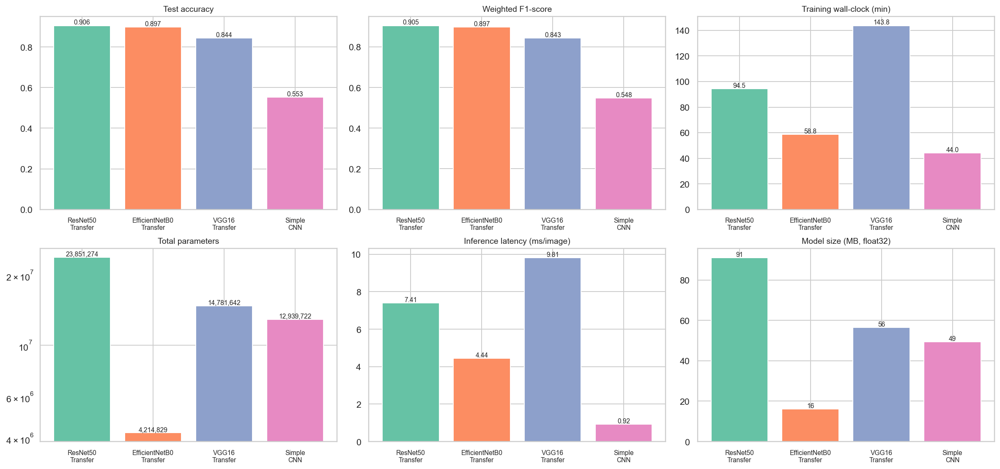
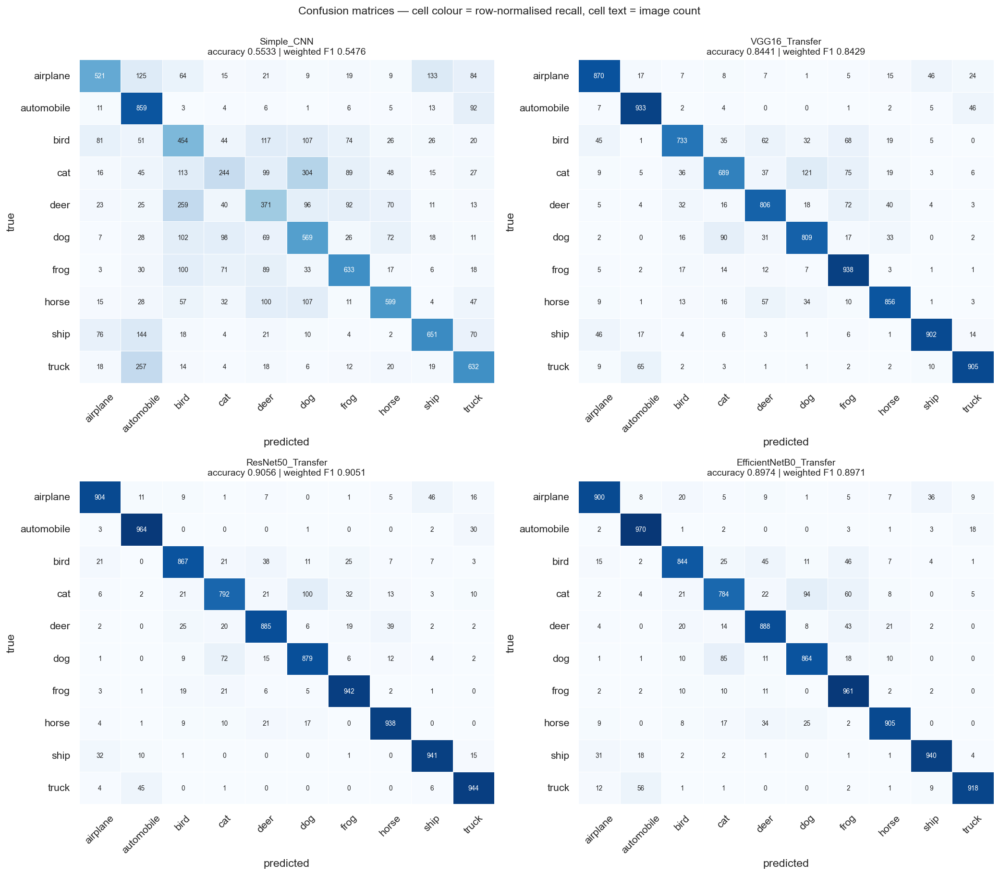
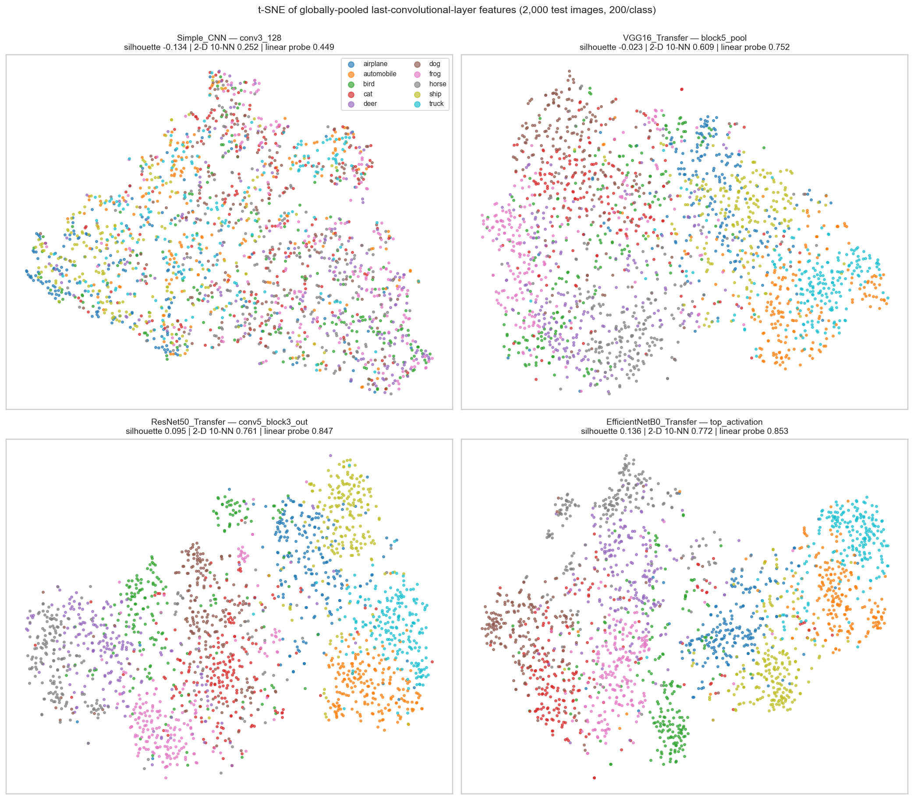
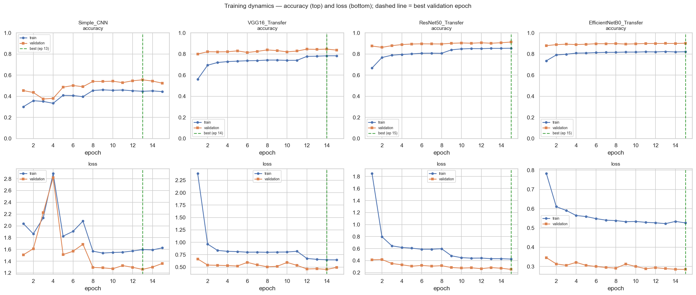
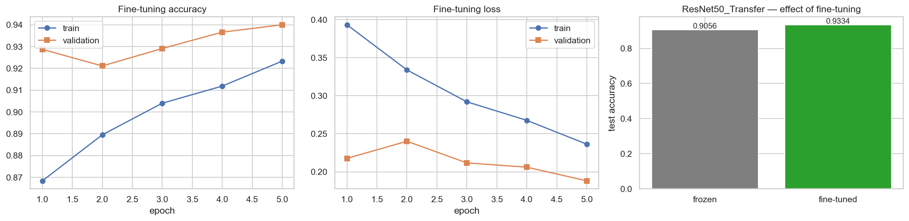
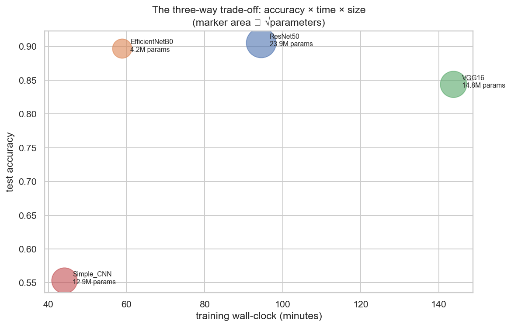

<div align="center">

# CIFAR-10 Image Classification with Deep Convolutional Networks

### Training from scratch vs. ImageNet transfer learning — an empirical study of accuracy, cost and learned representations

**Jyothi Kodenkiri** · Master's research project in Artificial Intelligence & Machine Learning


**[📄 Project Report (PDF)](report/Analysis_Report.pdf)** ·
**[📊 Performance Summary (PDF)](report/Model_Performance_Summary.pdf)** ·
**[📓 Notebook](CIFAR10_CNN_Capstone.ipynb)** ·
**[🗂 Results JSON](cnn_lab_results.json)**

</div>

---

## Abstract

This project asks a practical question: **given a fixed 60,000-image, 10-class benchmark and
a limited compute budget, which convolutional architecture gives the best accuracy per unit of
cost, and what do the learned representations tell us about why?**

Four architectures are built, trained and compared on CIFAR-10: a custom CNN trained from
scratch, and three ImageNet backbones (VGG16, ResNet50 and EfficientNetB0) used as frozen
feature extractors with an identical classification head. Every model is trained on the same
stratified 40,000 / 10,000 train/validation split and evaluated **once** on the untouched
10,000-image test set.

Beyond headline accuracy, the study measures training time, inference latency, model size,
calibration and feature quality (activation sparsity, linear-probe accuracy, silhouette scores
and t-SNE). A controlled ablation study then varies batch size, learning rate, dropout, input
resolution and network depth. Finally, it runs fine-tuning, k-fold cross-validation,
ensembling, TFLite quantisation, pruning and latency benchmarking.

**Key result:** a frozen ResNet50 backbone reaches **90.56 %** test accuracy. Unfreezing its
final stage lifts this to **93.34 %**, and a two-model soft-voting ensemble reaches **92.19 %**.
The same custom CNN gains **17.8 points** when fed native 32×32 images instead of upscaled
224×224 ones. Upscaling adds pixels, not information.

---

## Headline results (10,000 unseen test images)

| Rank | Model | Test acc. | F1 (weighted) | Top-5 | Total params | Trainable | Train time | Inference | Size |
|:---:|---|:---:|:---:|:---:|---:|---:|---:|---:|---:|
| 1 | **ResNet50 (transfer)** | **0.9056** | **0.9051** | 0.9976 | 23.9 M | 264 K | 94.5 min | 7.4 ms/img | 91.0 MB |
| 2 | EfficientNetB0 (transfer) | 0.8974 | 0.8971 | 0.9970 | 4.2 M | 165 K | 58.8 min | 4.4 ms/img | 16.1 MB |
| 3 | VGG16 (transfer) | 0.8441 | 0.8429 | 0.9942 | 14.8 M | 67 K | 143.8 min | 9.8 ms/img | 56.4 MB |
| 4 | Simple CNN, native 32×32 | 0.7315 | 0.7229 | 0.9798 | 0.36 M | 0.36 M | 5.6 min | 0.11 ms/img | 1.4 MB |
| 5 | Simple CNN, 224×224 | 0.5533 | 0.5476 | 0.9472 | 12.9 M | 12.9 M | 44.0 min | 0.92 ms/img | 49.4 MB |

### Advanced experiments

| Experiment | Outcome |
|---|---|
| Fine-tuning ResNet50 (`conv5` stage unfrozen, LR 1e-5, 5 epochs) | 0.9056 → **0.9334** (+2.78 pts) |
| Ensemble: top-2 soft voting (ResNet50 + EfficientNetB0) | **0.9219** accuracy, 0.9216 F1 |
| Ensemble: all four, weighted soft voting | 0.9160 |
| TFLite quantisation of ResNet50 (fp32 → int8) | 90.6 MB → **23.1 MB**, accuracy unchanged on a 300-image evaluation subset |
| Batch-1 latency | Simple CNN ≈ 268 fps · VGG16 ≈ 94 fps · ResNet50 ≈ 60 fps |
| Stratified 3-fold cross-validation (Simple CNN) | Validation accuracy 0.423 ± 0.008 |

---

## Visual highlights

<table>
<tr>
<td width="50%"><br><sub><b>Model comparison</b>: accuracy, F1 and cost across the four architectures</sub></td>
<td width="50%"><br><sub><b>Confusion matrices</b> on the 10,000-image test set</sub></td>
</tr>
<tr>
<td><br><sub><b>t-SNE of last-layer features</b>: class separability by architecture</sub></td>
<td><br><sub><b>Training and validation curves</b> with callback events</sub></td>
</tr>
<tr>
<td><br><sub><b>Fine-tuning ResNet50</b>: before vs. after unfreezing</sub></td>
<td><br><sub><b>Accuracy–efficiency trade-off</b> synthesis</sub></td>
</tr>
</table>

All 41 figures are in [`figures/`](figures).

---

## Key findings

1. **Transfer learning dominates on a small-image benchmark.** ResNet50 is the most accurate
   architecture, and McNemar's exact test confirms its lead is statistically significant.
2. **Parameter count predicts training cost backwards.** ResNet50 holds 1.6× VGG16's parameters,
   yet trains in about two-thirds of the time and scores higher. VGG16 runs wide 3×3 convolutions
   at high resolution, while ResNet50 spends its depth on cheap 1×1 bottlenecks.
3. **Learning rate is the highest-leverage hyper-parameter.** Changing it by one order of
   magnitude moved accuracy more than switching architecture. At 1e-2 the from-scratch CNN
   collapses to chance (10 %).
4. **Deeper can mean smaller.** Adding a convolutional block to the custom CNN *reduced* its
   parameter count. About 99 % of its weights sit in the `Flatten → Dense` transition, not in
   the convolutions.
5. **Upsampling adds pixels, not information.** At native 32×32 the custom CNN uses 36× fewer
   parameters, trains 7.9× faster and is 17.8 points more accurate. 224×224 input helps only the
   pre-trained backbones.
6. **Feature size is not feature quality.** The custom CNN's final feature map is the largest,
   yet it scores lowest on both linear-probe accuracy and t-SNE separability.

**Deployment recommendation:** use fine-tuned ResNet50 when accuracy matters most,
EfficientNetB0 for the best accuracy per megabyte, and the native-resolution custom CNN with
TFLite quantisation for real-time or edge use.

---

## Methodology

```
CIFAR-10 archive ──► train.csv / test.csv (1 label + 3,072 pixel columns)
        │
        ├─► stratified split: 40,000 train · 10,000 validation · 10,000 test (held out)
        │
        ├─► augmentation (train only): flips · ±15° rotation · ±10 % shifts · pad-and-crop
        │
        ├─► four architectures ──► identical training protocol
        │      Simple CNN (from scratch)          EarlyStopping (val_loss)
        │      VGG16      ┐                       ReduceLROnPlateau
        │      ResNet50   ├─ frozen ImageNet      ModelCheckpoint (best val_accuracy)
        │      EfficientNetB0 ┘ + GAP→Dense(128)→Dropout→Softmax
        │
        ├─► evaluation: accuracy · F1 · top-5 · confusion matrices · calibration · error analysis
        ├─► feature analysis: activation statistics · linear probes · silhouette · t-SNE
        ├─► ablations: batch size · learning rate · dropout · image size · depth (13 runs)
        └─► advanced: fine-tuning · k-fold CV · ensembles · quantisation · pruning · latency
```

**Leakage control.** The test set is never used for model selection, early stopping or
normalisation statistics. Validation and test pipelines are never shuffled, so prediction
order always matches label order.

**Reproducibility.** All randomness is seeded (`SEED = 42`) across Python, NumPy, TensorFlow
and `PYTHONHASHSEED`. Every training run writes verbatim Keras logs and per-epoch CSVs to
[`artifacts/`](artifacts), so any number in the report can be traced to its source run.

---

## Repository structure

```
.
├── CIFAR10_CNN_Capstone.ipynb     # fully executed research notebook (all outputs visible)
├── CIFAR10_CNN_Capstone.html      # same notebook, viewable in any browser
├── cnn_lab_results.json           # complete structured results
├── cnn_lab_comparison.csv         # model comparison table
├── report/
│   ├── Analysis_Report.pdf        # full project report (methods, results, analysis)
│   ├── Analysis_Report.md
│   ├── Model_Performance_Summary.pdf
│   └── Model_Performance_Summary.md
├── code/
│   ├── capstone_lib.py            # shared library: data, models, training, evaluation, features
│   ├── scripts_build_csv.py       # builds train.csv / test.csv from the CIFAR-10 archive
│   ├── run_main.py                # trains and evaluates the headline models
│   ├── run_features.py            # feature extraction, activation statistics, t-SNE
│   ├── run_paramtests.py          # parameter-modification (ablation) study
│   ├── run_challenges.py          # fine-tuning, CV, ensembles, compression, latency
│   ├── make_notebook.py, nb_part*.py   # notebook source
│   ├── make_reports.py            # regenerates the report and summary
│   └── requirements.txt
├── artifacts/                     # per-epoch logs, model summaries, metrics, probabilities, t-SNE
├── figures/                       # all 41 figures
├── data/                          # dataset manifest (SHA-256), 100-row samples, rebuild notes
├── requirements.txt
├── CITATION.cff
└── LICENSE
```

Trained weights (`*.h5`, `*.tflite`) and the full CSVs (~629 MB) are not committed because of
their size. They can be regenerated with the steps below.

---

## Reproducing the results

```bash
git clone https://github.com/u2jyothibhat/cifar10-cnn-transfer-learning.git
cd cifar10-cnn-transfer-learning
python -m venv .venv && source .venv/bin/activate
pip install -r requirements.txt          # on Linux/Windows, drop tensorflow-metal
export PYTHONPATH=code

# 1. Data: download and convert CIFAR-10 to CSV (see data/README.txt)
mkdir -p data extracted_files
curl -L https://www.cs.toronto.edu/~kriz/cifar-10-python.tar.gz | tar -xz -C extracted_files
python code/scripts_build_csv.py

# 2. Experiments (results and logs are written to artifacts/)
python code/run_main.py
python code/run_features.py
python code/run_paramtests.py
python code/run_challenges.py

# 3. Notebook and reports
jupyter nbconvert --to notebook --execute --inplace CIFAR10_CNN_Capstone.ipynb
python code/make_reports.py
```

**Hardware used:** Apple Silicon (arm64) with Metal GPU acceleration, Python 3.9.6,
TensorFlow 2.16.2, Keras 3.10.0. Full-scale training of all experiments takes several GPU-hours.

---

## Dataset

[CIFAR-10](https://www.cs.toronto.edu/~kriz/cifar.html) has 60,000 colour images (32×32),
6,000 per class: airplane, automobile, bird, cat, deer, dog, frog, horse, ship and truck.
It is split into 50,000 training and 10,000 test images.

> Krizhevsky, A. (2009). *Learning Multiple Layers of Features from Tiny Images*. Technical report, University of Toronto.

## References

- He, K., Zhang, X., Ren, S. & Sun, J. (2016). Deep residual learning for image recognition. *CVPR*.
- Simonyan, K. & Zisserman, A. (2015). Very deep convolutional networks for large-scale image recognition. *ICLR*.
- Tan, M. & Le, Q. (2019). EfficientNet: Rethinking model scaling for convolutional neural networks. *ICML*.
- Yosinski, J., Clune, J., Bengio, Y. & Lipson, H. (2014). How transferable are features in deep neural networks? *NeurIPS*.
- van der Maaten, L. & Hinton, G. (2008). Visualizing data using t-SNE. *JMLR*, 9, 2579–2605.
- Guo, C., Pleiss, G., Sun, Y. & Weinberger, K. Q. (2017). On calibration of modern neural networks. *ICML*.

## Citation

```bibtex
@misc{kodenkiri2026cifar10,
  author       = {Kodenkiri, Jyothi},
  title        = {CIFAR-10 Image Classification with Deep Convolutional Networks:
                  Training from Scratch vs. ImageNet Transfer Learning},
  year         = {2026},
  howpublished = {\url{https://github.com/u2jyothibhat/cifar10-cnn-transfer-learning}},
  note         = {Master's research project, Artificial Intelligence and Machine Learning}
}
```

## Licence

Code is released under the [MIT Licence](LICENSE). CIFAR-10 is distributed by its authors
under its own terms.
